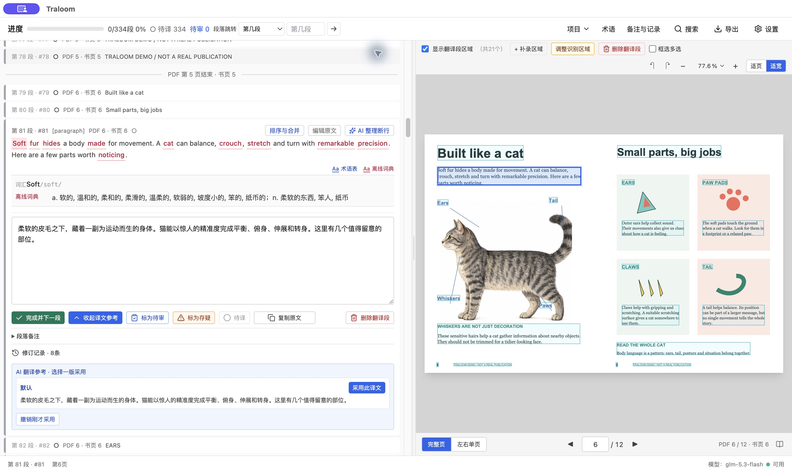
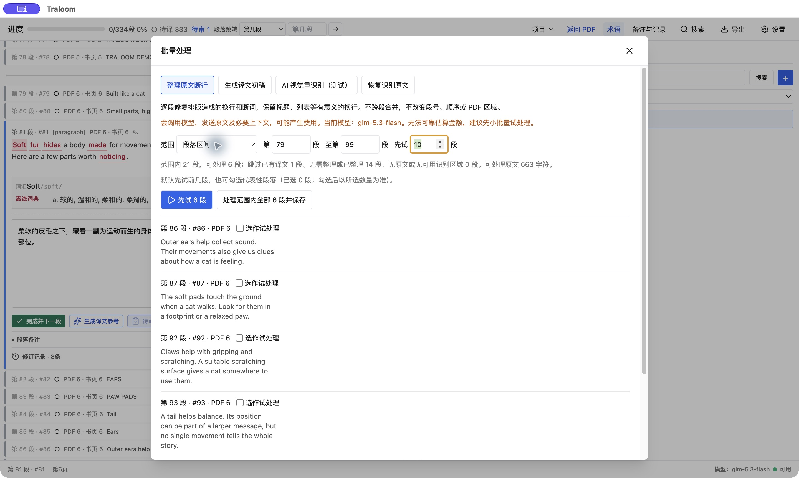
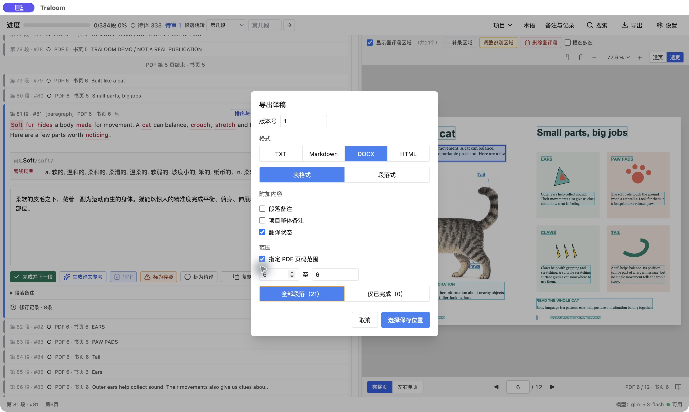

# Traloom

[English](README.en.md) | 简体中文

**从一本 PDF，到一份可以交付的中文译稿。**

Traloom 是一款开源的 AI 辅助翻译桌面工作台。把原书、译文、术语、备注和审校进度放在一起，让你专注于理解和打磨文字，而不是在 PDF、聊天窗口和文档之间来回搬运。

为图书、杂志、图文出版物和技术手册的中文翻译而设计。你可以自己翻译，也可以请 AI 提供参考；**最终用哪个词、怎样表达、是否通过，始终由你决定。**

[下载 Mac 预览版](https://github.com/banzhitudou/traloom/releases) · [用示例 PDF 试一试](docs/demo-pdfs.md) · [功能介绍](#不只是生成译文) · [从源码运行](#从源码运行) · [反馈问题](https://github.com/banzhitudou/traloom/issues)



*看着原页翻译：原文、中文译稿、词典与已有 AI 参考在同一个工作界面。截图使用公开的英语猫示例资料；译文仅用于演示界面，不是出版成稿。*

> 项目仍在早期开发。下文介绍当前源码的能力，已发布安装包可能尚未包含全部更新。主要在 Apple Silicon Mac 上验证，界面以简体中文为主，译文目标目前为简体中文。AI 视觉识别与整页分块仍为测试功能。

## 一本书的工作，可以连起来做

**选择 PDF → 核对原文 → 翻译与精修 → 统一术语 → 审校 → 导出交付**

新建工程只需要一本 PDF，不必先准备一套术语表、整理好的文本或其他配套资料。工程会生成在 PDF 所在文件夹，不覆盖原书。资料可以边做边补，AI 也可以稍后再配置。

## 英语与日语：识别支持范围

**Traloom 不是日语专用工具。内置离线 OCR 同时支持英语与日语，默认是英语横排。**

| 识别方式 | 当前支持范围 | 是否使用模型服务 |
| --- | --- | --- |
| 内置英语 OCR | 英语印刷体横排，使用 `eng` 模型；默认选项 | 否，在本机运行 |
| 内置日语 OCR | 日文印刷体横排选 `jpn`，竖排选 `jpn_vert`；需要选择对应方向 | 否，在本机运行 |
| PDF 文字层提取 | 读取 PDF 已有文字，不等于 OCR；结果取决于字体编码、文字层和版面质量 | 否，在本机运行 |
| AI 视觉识别（测试） | 英语、日语及其他语言能否识别，取决于所配置的图片模型，不保证覆盖所有语言或达到同样准确率 | 是，上传所选图像，可能收费 |

其他扫描语言的本机 OCR 模型目前未内置。旋转页面不等于支持英语竖排；日文混排、振假名、手写字及模糊扫描仍需人工核对。上述是**原文识别范围**，不是界面或译文语言设置：目前界面以简体中文为主，AI 译文目标为简体中文。

## 不只是生成译文

### 看着原书翻，不丢掉版面里的上下文

图注在说哪张图？这句是正文、标题，还是角落里的说明？

Traloom 把 PDF 与翻译段放在同一个工作界面，让你对照原页逐段编辑，查看文字对应的区域。识别漏了可以补框，段落不合理可以排序、合并或拆分，不用因为一个错框从头再来。

- 支持 PDF 页码、书中页码和段落编号定位，长书也能快速跳转。
- 支持跨页阅读、页面旋转、缩放，以及识别区域调整。
- 有文字层的 PDF 优先提取文字；内置离线 OCR 支持英语、横排日文和竖排日文。

识别结果需要核对，尤其是数字、单位、小字、振假名与复杂图文混排。内置 OCR 不代表支持所有语言。

### 让 AI 提供选择，而不是替你决定文风

同一段话，可以需要准确克制，也可以需要自然流畅。没有一种预设风格适用于所有书。

- 保存 **1–5 个译文参考方案**，分别命名、填写翻译要求，再按需要生成多种参考。
- 默认方案的要求可以查看、修改，也可以恢复内置设置，不把特定读者年龄或文体写死。
- 自行配置兼容的模型服务；译文参考、AI 整理断行、视觉识别可以分配不同模型。
- 生成参考时带入匹配的项目术语，让已有译名成为约束，而不只是一张旁边的词表。

**不启用 AI，也可以做原文核对、人工翻译、术语管理、审校和导出。** AI 模型不随软件内置；使用 AI 需要自行配置相应服务。

### 先试几段，再决定要不要处理全书

几十页、几百页的书，不必一开始就把整本内容交给模型。

在“项目 → 批量处理”中，可以独立运行 **整理原文断行** 和 **生成译文初稿**，选择全部符合条件的段落或一个区间。先试 10 段，也可以自己调整数量，或挑选有代表性的段落。

- 先看试处理对照，再决定采用、放弃或继续处理剩余部分。
- 批量初稿可以选用已保存的译文参考方案，采用后进入待审，不自动通过。
- 默认跳过已有译文的段落，写入前再次检查是否发生人工修改。
- 支持暂停与继续，任务记录随工程保存；结果未知的中断请求不会自动重试。
- 保留原始识别记录的段落，可以单独或按区间恢复识别原文。合并过、没有原始记录等不符合条件的段落会跳过；这不是任意操作的“一键撤销”。

先试同样可能产生模型费用，并非免费试用。AI 整理断行只处理段内换行与断词，不替你跨段合并或重新编排全书。



*先选范围，再决定试多少段。这里展示的是处理前的设置，没有运行任务，也没有为截图发起模型请求。*

### 统一全书译名，也给合理的例外留位置

一本书翻到最后，难的往往不是某个词不会翻，而是同一个词在不同页面出现了好几种译法。

- 手工建立项目术语，分类管理人名、地名、专业术语等。
- 查看原文中的出现次数，筛选“未采用标准译名”的条目，直接找到需要核对的段落。
- 原文与可识别的旧译名高亮显示，替换前预览，支持逐处或批量处理。
- 从检查结果直接修改术语，不必退出检查流程去找词条。
- 对“这个地方这样翻才合适”的情况，可以认可此处译名，而不是被迫全书一刀切。
- 词组优先于被其包含的单词；识别部分规则英语复数，减少重复和误报。

术语检查是辅助核对，不等于自动判断翻译对错；中文旧译名的定位也不能覆盖所有表达方式。

### 翻完、审过、还存疑，分得清

用 **待译、待审、存疑、通过** 管理进度。筛选一种状态后，可以沿着这类段落继续工作；已经有文字的译稿，也不必假装已经审完。

日常译文编辑自动保存。段落备注、项目备注和修订记录放在工程里，方便记下疑点、追踪修改、回看之前的版本。原文和译文都能搜索，不用只凭记忆找某一页。

### 交给编辑和美编的，不只是一个文本文件

**DOCX：适合审读与继续编辑。**

- 表格式对照稿，或不带表格的段落稿。
- 双语段落稿按原文、中文依次排列。
- 表格稿可将段落编号、书中页码放在定位列，便于核对。
- 按页面范围导出，可选择备注，并填写交付版本号；项目中填写的书名、译者等资料可带入稿件。



*只想交接一页，也可以只导出一页。截图展示 DOCX 选项，HTML 是另一种独立导出格式。*

**HTML：适合按页查看与排版交接。**

- 在浏览器中切换中文、原文、双语对照，不需要安装 Traloom 才能打开成品。
- 按页查看，支持左右方向键翻页、搜索、页码跳转、适页、适宽和独立缩放。
- 对照栏可以收起，让主要页面占据屏幕。
- 点击页面中的译文块即可复制文字，结合段号和页码定位，减少美编来回查找。
- 可选择是否附带备注，只导出需要交接的页面。

HTML 是阅读与交接预览，不是印刷成品，也不承诺自动还原原书版式或直接生成专业排版软件工程。

### 把工程带走，不必重新寻找一堆附件

新建工程使用单个 **`.twproj` 文件**，内嵌原书 PDF、识别资料、译文、术语、备注和修订记录等资源。移动这个文件后，可以重新打开继续工作。

工程保存在本机。手动备份时，先退出程序，再复制工程文件。旧版工程可能仍依赖外部 PDF；跨电脑使用时，模型 API Key 也可能需要重新填写。

## 和业界知名 CAT 软件有什么不同？

CAT 就是“计算机辅助翻译”。成熟工具在翻译记忆复用、多种文件格式和团队本地化流程方面有长期积累。Traloom 选择的是更聚焦的方向：**围绕一本 PDF，把个人翻译、原页核对和出版交接做成一个连贯流程。**

| 你眼前的工作 | Traloom 的选择 |
| --- | --- |
| 手上只有一本原书 PDF，想尽快开始 | 以 PDF 为单一新建入口，边翻边补充资料 |
| 图文混排，需要反复确认某段位于哪里 | 将 PDF 区域、段落编号、书中页码与译稿联系起来 |
| 想让大模型帮忙，但不想接受统一文风 | 自选模型，自定义参考方案，由译者决定最终表达 |
| 全书已经翻完，想统一译名再交稿 | 术语检查、替换预览、局部译名认可与审校状态 |
| 需要把原文和中文交给编辑、美编核对 | 导出对照 DOCX 与可定位、可复制的 HTML |

这里比较的是工作重心，不是声称其他工具没有这些能力。Traloom **目前不提供完整的翻译记忆库、TMX/XLIFF 交换或多人实时协作**，也不把替代成熟 CAT 系统作为现阶段承诺。需要这些能力的专业生产流程，成熟工具仍然更合适。[翻译记忆库的概念参考](https://joint-research-centre.ec.europa.eu/language-technology-resources/dgt-translation-memory_en)

## AI 视觉识别：可以试，但请先核对

对于难以直接提取的区域，可选择支持图片的模型进行视觉识别；“项目 → AI 整页识别与分块（测试）”还可以尝试整页文字提取、分块和阅读顺序预览。

整页识别支持选择页码和少量试用，预览中可调整文字、边界及顺序。**已有翻译段的页面只能作对照预览，禁止覆盖式重分块。** 空白待识别页也必须逐页确认后才写入。

这仍是实验能力，可能漏字、错字、框偏移或顺序错误，不适合未经核对就对整本书自动采用。会上传所选区域或页面图像，可能产生服务费用。详见 [视觉识别说明](docs/vision-ocr.md)。

## 开始使用

1. 从 [Releases](https://github.com/banzhitudou/traloom/releases) 下载 Mac 预览版，或按下方说明从源码运行。
2. 新建项目，选择 PDF，核对识别出的段落与区域。
3. 直接人工翻译；需要 AI 时，再到“设置”配置模型与译文参考方案。
4. 先用少量段落试处理，继续精修、检查术语和审校。
5. 按需要的页码范围导出 DOCX 或 HTML。

没有适合练习的 PDF？[示例说明](docs/demo-pdfs.md)提供原创演示资料的下载入口，包含单页、跨页、旋转文字和图像文字，可用于体验，不含私人书稿、工程或密钥。

Mac 预览安装包目前使用临时签名，尚未完成 Apple Developer ID 签名及公证，可能出现系统安全或钥匙串授权提示。Windows 有构建配置，但发行包尚未完成独立验证。

## 本地保存，不等于 AI 离线

- **软件开源，模型服务另计。** 软件代码采用 MIT 许可证；AI 服务是否收费、如何处理数据，取决于你选择的供应商。
- **人工工作与内置 OCR 可以离线。** 使用 AI 时，相应原文、上下文、术语或图像会发送到配置的服务，不会因为工程保存在本机就变成离线处理。
- **工程是私人资料，不是源码附件。** `.twproj` 可能包含整本原书、译文和个人备注，不要上传到公开仓库；API Key 也不要公开。
- **请自行备份。** 日常自动保存不等于自动备份；程序不会定时生成备份副本。
- **原书版权仍属于权利人。** MIT 软件许可不授予用户导入书稿、图片或其他资料的使用权。

## 从源码运行

需要 Node.js 22.12 或更新的受支持版本，推荐 Node.js 24 LTS，以及 npm。安装时会为 Electron 构建 SQLite 原生模块，部分平台需要本机编译工具。

```sh
npm ci
npm run dev
```

开发版使用独立的 `translation-workbench-dev` 应用数据目录。测试已有工程时，请打开副本。

```sh
npm test
npm run typecheck
npm run build
```

测试使用合成数据，不需要真实书稿。打包命令：

```sh
npm run build:mac
npm run build:win
```

Apple Silicon Mac 可用 `npm run package:mac:local` 生成临时签名的本地测试应用，输出到 `dist/local/`。公开发行仍需对应平台测试、签名及必要的公证。

为兼容已有工程，产品保留原应用标识、安装版的 `translation-workbench` 数据目录与 `.twproj` 后缀。

## 进一步了解与参与

[批量处理](docs/batch-processing.md) · [日文 OCR](docs/japanese-ocr.md) · [视觉识别](docs/vision-ocr.md) · [贡献指南](CONTRIBUTING.md) · [安全报告](SECURITY.md) · [发布准备](docs/release-preparation.md)

欢迎用自制示例反馈问题、分享工作流程或参与开发。提交截图和工程前，请移除私人书稿、密钥与个人信息。

Traloom 读作 **tra-LOOM**，近似“特拉卢姆”，名字结合 Translation 与 Loom：AI 提供参考，译者编织最终的文字。

软件许可：[MIT](LICENSE)。词典、OCR 模型及其他第三方资源保留各自授权，见 [THIRD_PARTY_NOTICES.md](THIRD_PARTY_NOTICES.md)。
